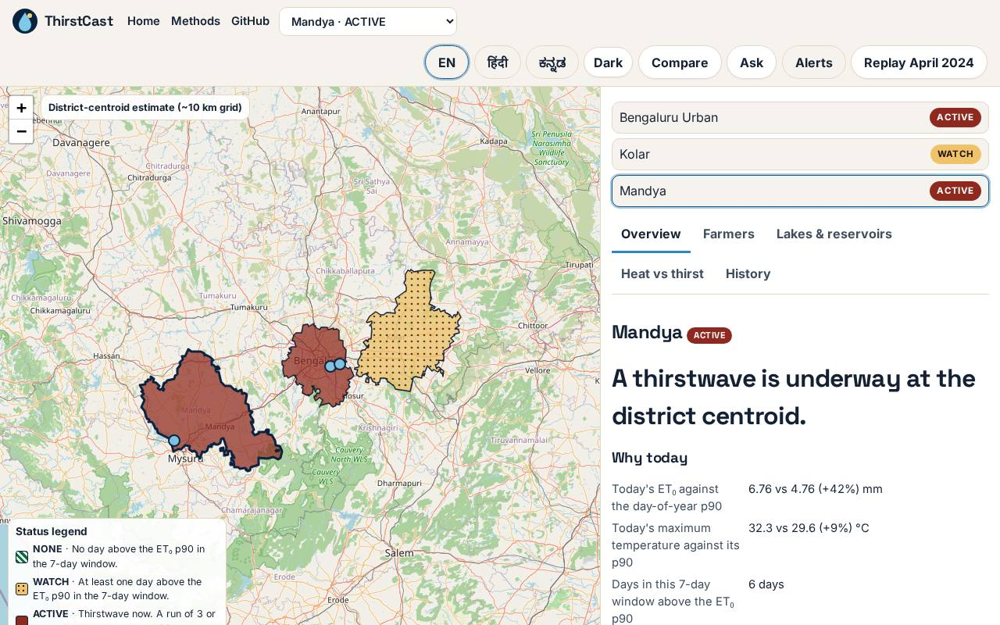
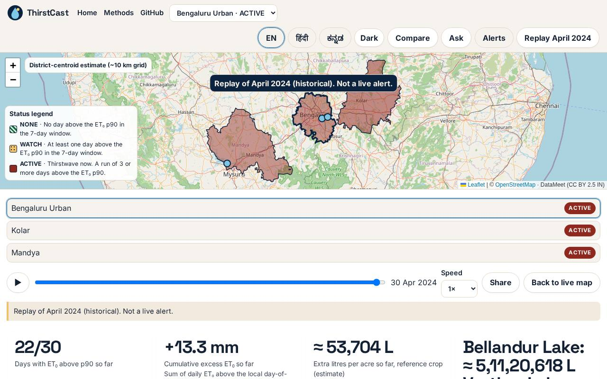
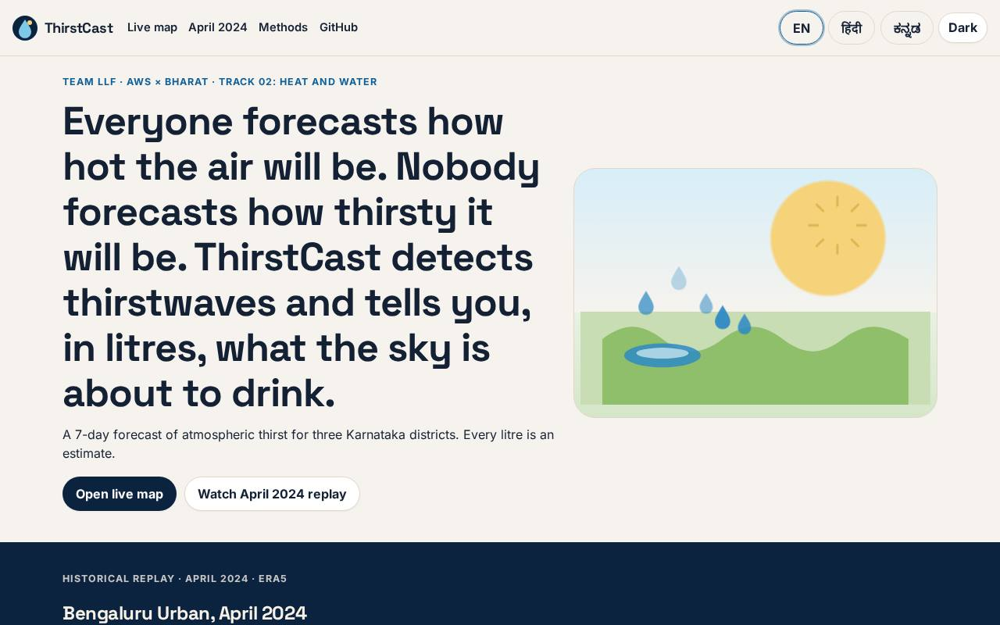
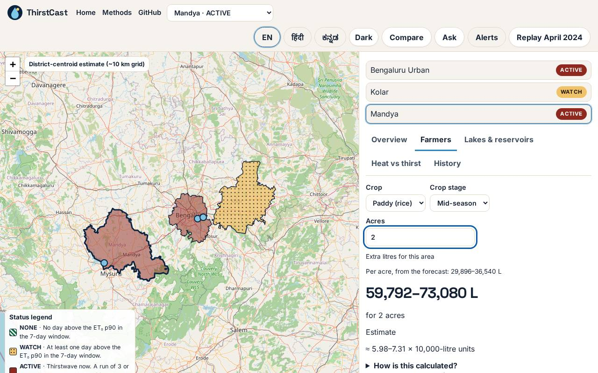
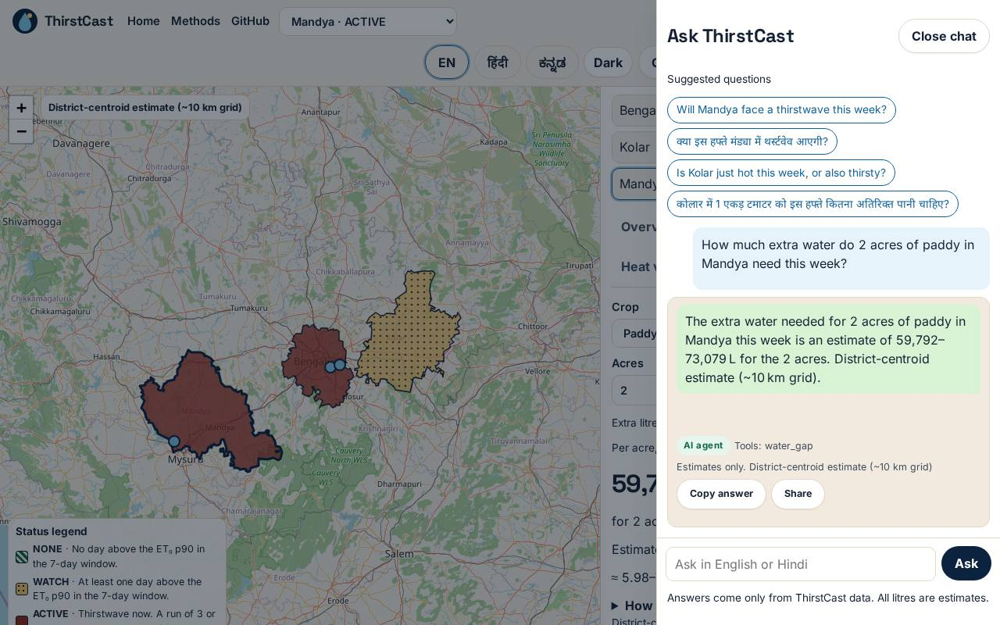
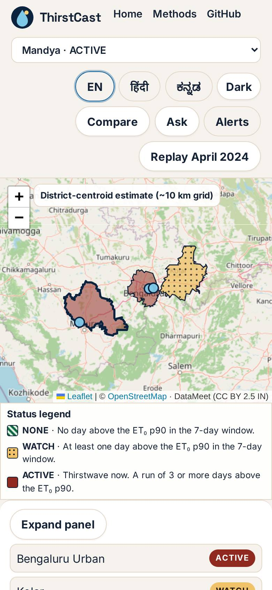
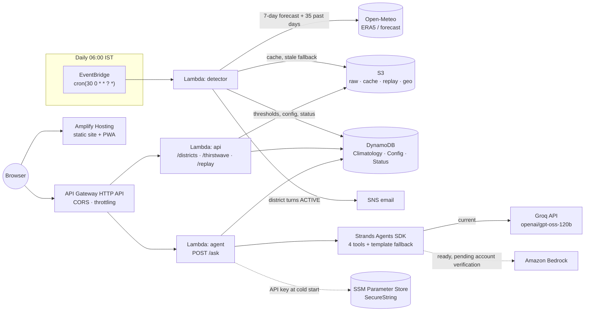

<div align="center">

# ThirstCast 💧

### Everyone forecasts how hot the air will be. Nobody forecasts how thirsty it will be.

ThirstCast detects **thirstwaves** (runs of extreme atmospheric water demand) in Karnataka. It turns them into
**litres** for farmers and lake managers, and explains them in English and Hindi through an AI agent that answers
only from the data.

[](https://main.d2hlw69ycq26ka.amplifyapp.com)
[](https://zjqxh2um0d.execute-api.ap-south-1.amazonaws.com/districts)
[](backend/template.yaml)
[](#)
[](LICENSE)
[](#local-development)

<a href="https://main.d2hlw69ycq26ka.amplifyapp.com/app.html"></a>

<sub>Live dashboard, 11 Oct 2026. Mandya and Bengaluru Urban are in an active thirstwave; Kolar is on watch.</sub>

</div>

---

## Contents

1. [Quick links](#quick-links)
2. [Try it in 30 seconds](#try-it-in-30-seconds)
3. [The problem](#the-problem)
4. [Evidence](#evidence)
5. [Features](#features)
6. [Architecture](#architecture)
7. [Methods](#methods)
8. [API reference](#api-reference)
9. [Repository structure](#repository-structure)
10. [Local development](#local-development)
11. [Deploy](#deploy)
12. [Claims and honesty](#claims-and-honesty)
13. [Limitations](#limitations)
14. [Roadmap](#roadmap)
15. [Team LLF](#team-llf)
16. [Data credits and licences](#data-credits-and-licences)

---

## Quick links

| What | Link |
|---|---|
| 🌐 Live app (landing) | https://main.d2hlw69ycq26ka.amplifyapp.com |
| 🗺️ Live dashboard | https://main.d2hlw69ycq26ka.amplifyapp.com/app.html |
| 📐 Methods page | https://main.d2hlw69ycq26ka.amplifyapp.com/methods.html · source [docs/methods.md](docs/methods.md) |
| 🔌 API base URL | `https://zjqxh2um0d.execute-api.ap-south-1.amazonaws.com` (try [/districts](https://zjqxh2um0d.execute-api.ap-south-1.amazonaws.com/districts)) |
| 🧪 Backup preview (GitHub Pages, **mock data**) | https://aneek22112007-tech.github.io/thirstcast/ |
| 🎬 Demo video (3 min) | _TODO: link_ |
| 🖼️ Slides | _TODO: link_ |
| 🔢 Every number we quote | [docs/numbers.md](docs/numbers.md) (generated by the pipeline) |

---

## Try it in 30 seconds

```bash
API=https://zjqxh2um0d.execute-api.ap-south-1.amazonaws.com

# 1. Today's status for the three pilot districts
curl -s $API/districts

# 2. Mandya: 7-day forecast, excess ET0 and litres
curl -s $API/thirstwave/Mandya

# 3. Ask the agent (English or Hindi)
curl -s -X POST $API/ask -H 'content-type: application/json' \
  -d '{"question":"Will Mandya face a thirstwave this week?"}'
```

Real responses, trimmed, fetched from the live API on **11 Oct 2026, 17:48 IST**. Statuses change daily.

```jsonc
// 1. GET /districts
{"districts": [
  {"id": "Bengaluru_Urban", "name": "Bengaluru Urban", "status": "ACTIVE", "day_in_wave": 2, "updated_at": "2026-10-11T16:22:10+05:30", ...},
  {"id": "Kolar",           "name": "Kolar",           "status": "WATCH",  "day_in_wave": 0, ...},
  {"id": "Mandya",          "name": "Mandya",          "status": "ACTIVE", "day_in_wave": 2, ...}],
 "caveat": "District-centroid estimate (~10 km grid)"}

// 2. GET /thirstwave/Mandya
{"district": "Mandya", "status": "ACTIVE", "day_in_wave": 2, "run_date": "2026-10-11",
 "forecast": [{"date": "2026-10-11", "et0": 6.76, "p90": 4.76, "flag": true, "tmax": 32.3, "tmax_p90": 29.6, "tmax_flag": true}, ...],
 "forecast_wave": {"start": "2026-10-10", "end": "2026-10-16", "days": 7, "ongoing": true},
 "excess_mm_7d": 6.84,
 "excess_definition": "Sum over the 7 forecast days of max(bias-adjusted ET0 - day-of-year p90, 0)",
 "bias_offset_mm": -0.2,
 "extra_litres_per_acre": {"paddy": [29896, 36540], "sugarcane": [31142, 38062]},
 "extra_litres_lakes": {"KRS": {"value": 933660000, "label": "estimate"}},
 "caveat": "District-centroid estimate (~10 km grid)"}

// 3. POST /ask
{"answer": "Mandya is currently in an active thirstwave (day 2 of the wave). The wave runs from 2026-10-10 through 2026-10-16. This is a forecast, not a certainty. District-centroid estimate (~10 km grid)",
 "lang": "en", "mode": "llm", "tools_used": ["get_status"], "district": "Mandya",
 "caveat": "Estimates only. District-centroid estimate (~10 km grid)"}
```

Hindi works the same way: `-d '{"question":"क्या इस हफ्ते मंड्या में थर्स्टवेव आएगी?"}'`.

---

## The problem

India issues heat alerts (temperature) and drought alerts (rainfall deficit). No one tracks how fast the
atmosphere is **pulling water out** of fields, lakes and reservoirs. That rate is the *atmospheric evaporative
demand*, measured as reference evapotranspiration **ET₀** (FAO-56 Penman–Monteith). It depends on temperature,
humidity, wind and sunshine together, so a day can be extremely "thirsty" without being extremely hot.

**What is a thirstwave?** Kukal & Hobbins (2025, *Earth's Future*,
[doi:10.1029/2024EF004870](https://doi.org/10.1029/2024EF004870)) define thirstwaves as prolonged periods of
extreme evaporative demand. ThirstCast uses the operational form of that idea: **3 or more consecutive days with ET₀
above its local day-of-year 90th percentile.** For US cropland, 1981–2021, the abstract reports:

> "Weighted for cropland area harvested, thirstwave intensity, duration, and frequency have increased by 0.06 mm d⁻¹
> decade⁻¹, 0.10 days decade⁻¹, and 0.39 events decade⁻¹, respectively during 1981–2021. Statistically significant
> trends appear across 17%, 7%, and 23% of cropland area for intensity, frequency, and duration."

That is, significant trends cover **17% of cropland area for intensity, 7% for frequency and 23% for duration**.

In India the gap is plain. [The Hindu, 24 June 2025](https://www.thehindu.com/sci-tech/energy-and-environment/rising-evaporative-demand-spotlights-indias-data-and-research-gap/article69728191.ece):

> "This said, according to experts, there is essentially no data about extreme thirstwaves over India."

> **ET₀ is standard. Event-based thirstwave detection, locally thresholded and translated into litres per
> stakeholder, exists today as a research prototype in the US. To our knowledge, we are first to build it for India.**

---

## Evidence

### Bengaluru Urban, April 2024 (historical replay, ERA5)



| Metric (ERA5 `era5_seamless`, thresholds 1994–2023) | Bengaluru Urban | Kolar | Mandya |
|---|---|---|---|
| Days with ET₀ above its day-of-year p90 | **22 / 30** | 23 / 30 | 20 / 30 |
| Cumulative excess ET₀ ¹ | **+13.27 mm** | +12.2 mm | +11.7 mm |
| Extra water, reference crop (Kc = 1) | **≈ 53,704 L/acre** (≈ 0.54 lakh, estimate) | ≈ 49,576 L/acre | ≈ 47,350 L/acre |
| Days Tmax was above its own p90 | 24 / 30 | 22 / 30 | 24 / 30 |
| April rank, 1994–2024 | **1st of 31 (worst)** | 1st of 31 | 1st of 31 |

¹ *Cumulative excess* = **the sum of daily ET₀ above the local day-of-year p90 threshold.** Litres =
excess mm × 4,047 L per mm per acre. Bengaluru's next-worst April was 2023 at +4.7 mm.

> **Safe framing:** Bengaluru's 2024 water crisis was fundamentally a supply failure (a weak 2023 monsoon, failing
> borewells, Cauvery shortfalls). We do not claim thirstwaves caused it. We show the demand side nobody was measuring.
> Temperature was also high that April, so we don't claim heat alerts missed it either.

Source: [docs/numbers.md](docs/numbers.md), generated by `data/scripts/replay_april_2024.py`. The ERA5 series is
used everywhere; see [why not Open-Meteo's default model](docs/numbers.md).

### Blindspots: thirsty, not hot

Across 1994–2024 the finder found **129 blindspot events**: whole thirstwaves during which Tmax never rose above
its own p90, so a temperature-based alert would have stayed silent. The hot-season showcase is:

**Mandya, 8–14 April 2023**: 7 days, +2.62 mm excess ET₀, Tmax peaking at 36.2 °C, right at its p90 and never above it.

Full table: [data/out/blindspot_report.md](data/out/blindspot_report.md). In the app, see "Heat vs thirst" and the
"Thirsty, not hot" timeline.

### Live status (as of 11 Oct 2026, 16:22 IST detector run)

| District | Status | Day in wave | Forecast wave | 7-day excess | Example litres (estimate) |
|---|---|---|---|---|---|
| Bengaluru Urban | 🟥 ACTIVE | 2 | 10–16 Oct | 4.29 mm | Bellandur ≈ 1.65 crore L, Varthur ≈ 81 lakh L (upper bounds) |
| Kolar | 🟨 WATCH | 0 | – | 1.06 mm | tomato 4,440–5,427 L/acre · ragi 3,861–4,719 L/acre |
| Mandya | 🟥 ACTIVE | 2 | 10–16 Oct | 6.84 mm | paddy 29,896–36,540 L/acre · KRS ≈ 93 crore L (upper bound) |

These are forecasts and will change daily. The live numbers are at [`/districts`](https://zjqxh2um0d.execute-api.ap-south-1.amazonaws.com/districts).

---

## Features

| | Feature | What it does |
|---|---|---|
| 🗺️ | **Live map** | Leaflet map of the 3 districts (DataMeet boundaries). Status uses colour **and** pattern (NONE / WATCH / ACTIVE / UNKNOWN), with lake and reservoir markers. |
| 📑 | **5 district tabs** | Overview · Farmers · Lakes & reservoirs · Heat vs thirst · History. |
| ❓ | **Why today** | Today's ET₀ and Tmax against their own p90, days above p90 this week, the signed bias offset, the cumulative excess and a **thirst percentile** (where today sits in 30 years of the same ±7-day window). |
| 📈 | **History** | The 1994–2023 mean and p90 curve with today marked, plus a **Thirty Aprils** chart (1994–2024, 2024 highlighted). |
| ⚖️ | **Compare** | Side-by-side view of all three districts: status, excess, crop and lake litres, April 2024 rank, thirst percentile. |
| 🌾 | **Litres calculator** | Crop × acres, with a **crop stage** choice (FAO-56 Kc ini/mid/end), a Kc ±10% range, input validation and "How is this calculated?". |
| 🏞️ | **Lakes & reservoirs** | Bellandur, Varthur and KRS evaporation estimates, labelled as upper bounds, with area sources. |
| ⏪ | **April 2024 replay** | Day-by-day playback with scrub, speed, running counters, longest run, summary card and a shareable deep link. Always labelled historical. |
| 🔥 | **Thirsty, not hot** | Timeline of the 129 blindspot events, with daily ET₀ and Tmax charts. |
| 🤖 | **AI chat, EN + HI** | Strands agent with 4 tools. It answers only from tool output, gives ranges, replies in the user's language and shows an "AI agent" or "Template" badge plus the tools used. |
| 💬 | **Advisory preview** | Copy or share any answer as a text advisory. Share notes that ThirstCast does not send WhatsApp messages. |
| 🖼️ | **Share cards** | Export a 1200×630 image card (district or replay summary) with the caveat and date baked in. |
| 🌐 | **3 UI languages** | English, हिंदी and **ಕನ್ನಡ** (Kannada UI; chat answers come in English or Hindi). |
| 🌙 | **Dark mode** | Follows the system setting, with a manual toggle. |
| 📴 | **Offline / PWA** | Installable app with a service worker. Network-first, with saved data shown under an "offline" banner. |
| 🔗 | **Deep links** | `app.html#d=Mandya&tab=farmers`, `#replay=30`, `#view=compare`, `#ask=1&q=...`. Back/forward work. |
| 🖨️ | **Print bulletin** | One-page A4 district bulletin from the browser's print dialog. |
| ⌨️ | **Accessible** | Keyboard tabs and map, focus-trapped dialogs, AA contrast, reduced motion. |
| 🔔 | **Alerts** | The detector publishes to SNS when a district turns ACTIVE. Email sign-up from the site is not enabled yet. |

<table>
<tr>
<td><br><sub>Landing</sub></td>
<td><br><sub>Farmers: litres calculator</sub></td>
</tr>
<tr>
<td><br><sub>Chat: "AI agent" mode, tool <code>water_gap</code></sub></td>
<td align="center"><br><sub>Mobile (390 px)</sub></td>
</tr>
</table>

---

## Architecture



**About the LLM.** The agent is built for Amazon Bedrock. On this new AWS account, every Bedrock invocation currently
returns `ValidationException: Operation not allowed` (account verification is pending). For now `/ask` runs on
**Groq** (`openai/gpt-oss-120b`) through the same Strands agent, tools and prompt. Switching back is a single
deploy parameter: `ModelProvider=bedrock ModelId=<model or inference profile>`. On any LLM error, timeout or rate
limit, `/ask` returns a deterministic template advisory built from the same tools (`"mode": "template"`), so the
chat never breaks.

| AWS service | Used for | Why |
|---|---|---|
| **Lambda** (Python 3.12) | `detector`, `api`, `agent` functions; layers for the core, common and agent code | Serverless, pay-per-use. The core logic is pure Python and is shared by the Lambdas, tests and data scripts. |
| **EventBridge** | Daily schedule `cron(30 0 * * ? *)` = 06:00 IST | One run a day matches the daily forecast. |
| **DynamoDB** (on-demand) | Climatology (1,095 items), Config (10), Status (3) | Key-value lookups by district and day of year, with no idle cost. |
| **S3** | Raw archives, forecast cache (14-day lifecycle), replay files, GeoJSON | Cache plus stale fallback when Open-Meteo is down. |
| **API Gateway** (HTTP API) | Public REST API, CORS limited to the site's origin, throttling | Cheap and simple. Per-route throttle on `/ask`. |
| **SNS** | Email alert when a district turns ACTIVE | Honest replay alerts are tagged `[REPLAY April 2024]`. |
| **Amplify Hosting** | Static frontend at `main.d2hlw69ycq26ka.amplifyapp.com` | Zero-build static hosting over HTTPS. |
| **SSM Parameter Store** | Groq API key (SecureString) | The key is never in code, template or environment variables. IAM is scoped to that one parameter. |
| **CloudWatch Logs** | Function logs, 7-day retention | Debugging, with retention capped for cost. |
| **Bedrock** | LLM (ready, IAM in place) | Blocked until account verification completes. |

Deliberately **not** used: SageMaker (no model to train responsibly in a hackathon), OpenSearch (3 districts don't
need search) and Cognito (a public advisory tool needs no login).

**Open-source tools:** [Strands Agents SDK](https://github.com/strands-agents/sdk-python) (agent and tool calling),
[AWS SAM CLI](https://github.com/aws/aws-sam-cli) (infrastructure as code: [`backend/template.yaml`](backend/template.yaml)),
[Leaflet](https://leafletjs.com) (map), [Playwright](https://playwright.dev) (UI tests), [moto](https://github.com/getmoto/moto)
(AWS mocks in tests).

---

## Methods

The full write-up is in [docs/methods.md](docs/methods.md) and on the [live methods page](https://main.d2hlw69ycq26ka.amplifyapp.com/methods.html).

**Data.** Open-Meteo historical weather API with `models=era5_seamless` (ERA5 + ERA5-Land, about 10 km). Daily
`et0_fao_evapotranspiration` and `temperature_2m_max`, `timezone=Asia/Kolkata`, at each district centroid.
Open-Meteo's default `best_match` model switches from ERA5 to ECMWF IFS around 2017. That inflates recent years
(+0.45 mm/day for Bengaluru in 2024), so we use the consistent ERA5 series everywhere.

**Climatology.** For each district and each non-leap day of year *d* (Feb 29 is counted as day 59), take all
1994–2023 values in the window *d*−7 … *d*+7 (wrapping at the year end): about 450 values. Then compute the
**90th percentile** (numpy linear) for ET₀ and for Tmax. The result is 3 × 365 = **1,095 items**, with ET₀ p90
ranging from 4.14 to 7.52 mm/day.

**Detection.**
- A day is *flagged* when ET₀ > p90 for its day of year. For forecasts, the bias-adjusted ET₀ is used.
- A **thirstwave** is 3 or more consecutive flagged days.
- Status is **ACTIVE** when today is inside a run of 3 or more days, counting the past days. It is **WATCH** when
  at least one day in the 7-day window is flagged, **NONE** otherwise, and **UNKNOWN** when no status exists yet.

**Bias correction.**
- The detector requests 35 past days with the forecast.
- For days 6–30 before the run, it takes the mean of (forecast-model ET₀ − ERA5 ET₀) and subtracts it from the
  forecast.
- Offsets measured on 9 Oct 2026: Bengaluru Urban **+0.10**, Kolar **+0.09**, Mandya **−0.20** mm/day (daily
  SD ≈ 0.45–0.49).
- If |offset| > 0.5 mm/day, the API adds a `bias_note`.

**From millimetres to litres (all estimates).** 1 mm of water over 1 acre (4,046.86 m²) ≈ **4,047 L**.

- Crops: `excess_mm × Kc × 4,047 L/acre`, reported as a range with **Kc ±10%**.
- Lakes: `excess_mm × 1.05 × area_m²` (1 mm over 1 m² = 1 L), reported as an **upper bound**.

| Crop | FAO-56 Table 12 row | Kc mid (default) | Kc ini / end (crop-stage option) |
|---|---|---|---|
| Paddy | Cereals: Rice | **1.20** | 1.05 / 0.90–0.60 |
| Sugarcane | Sugar Cane | **1.25** | 0.40 / 0.75 |
| Tomato | Vegetables, Solanum family: Tomato | **1.15** | 0.6 (group) / 0.70–0.90 |
| Ragi (finger millet) | Cereals: Millet (no finger-millet row) | **1.00** | 0.3 (group) / 0.30 |
| Open water | Open Water, < 2 m depth or subhumid / tropics | **1.05** | – |

Allen et al. (1998), *FAO Irrigation and Drainage Paper 56*, [Table 12](https://www.fao.org/4/x0490e/x0490e0b.htm).
Crop config: [data/config/crops.json](data/config/crops.json).

| Water body | Area used | What the area is | Source |
|---|---|---|---|
| Bellandur Lake (Bengaluru Urban) | 366.89 ha | Legal lake extent (revenue records) | Ramachandra et al. 2017, IISc ENVIS TR-116, [sec. 2.1.1](https://wgbis.ces.iisc.ac.in/energy/water/paper/ETR116/sec2.html) |
| Varthur Lake (Bengaluru Urban) | 180.8 ha | Legal lake extent | same report, sec. 2.1.2 |
| KRS reservoir (Mandya) | 130 km² | Water spread at **full** reservoir level | [IRJET 6(9), 2019](https://irjet.net/archives/V6/i9/IRJET-V6I9196.pdf) |

All three are **upper bounds**: the actual water surface is usually smaller, especially in dry months.

**Validation.**
- The April 2024 replay uses archive data only, with no bias correction.
- The 1994–2023 Aprils are in-sample (they are part of the climatology); 2024 is out-of-sample.
- Every generator re-run reproduces the committed outputs byte for byte.

---

## API reference

Base URL: `https://zjqxh2um0d.execute-api.ap-south-1.amazonaws.com`. Responses are JSON (UTF-8), cached 60 s.
Full contract: [docs/api-contract.md](docs/api-contract.md).

District IDs: `Bengaluru_Urban`, `Kolar`, `Mandya`.

| Method & path | Returns | Errors |
|---|---|---|
| `GET /districts` | `{districts: [{id, name, lat, lon, status, day_in_wave, updated_at}], caveat}` | – |
| `GET /thirstwave/{district}` | `{district, status, day_in_wave, run_date, forecast[{date, et0, p90, flag, tmax, tmax_p90, tmax_flag}], forecast_wave{start, end, days, ongoing, extends_past_forecast} \| null, excess_mm_7d, excess_definition, bias_offset_mm, bias_note, extra_litres_per_acre{crop: [low, high]}, extra_litres_lakes{id: {value, label}}, updated_at, caveat, stale?, note?}` | `404 {"error":"unknown district"}` |
| `GET /replay/{district}` | April 2024: `{district, name, period, source, days[{date, et0, p90, flag, in_wave, excess_mm, cum_excess_mm, tmax, tmax_p90, tmax_flag}], summary{days_above_p90, days_total, days_in_wave, cum_excess_mm, cum_excess_definition, litres_per_acre_reference, tmax_days_above_p90, april_rank_1994_2024, april_years_compared, runs[], lakes{}}, caveat}` | `404 {"error":"unknown district"}` |
| `POST /ask` | Body `{"question": "...", "district": "optional hint"}` → `{answer, lang: "en"\|"hi", mode: "llm"\|"template", tools_used[], district, caveat}` | `400` if the body isn't JSON, the question is missing or empty, or it is over 500 characters |

- **Unknown paths:** return `404 {"message":"Not Found"}`.
- **Rate limits:** API Gateway defaults to 5 requests/s (burst 10). `POST /ask` is limited to **1 request/s
  (burst 2)**. Above that you get `429`.
- **Groq tier:** the free tier allows about 4 questions/min. Beyond that, `/ask` answers in `template` mode.
- **District hint:** a district named in the question wins over the `district` hint.
- **CORS:** the Amplify origin and localhost only.

---

## Repository structure

```text
thirstcast/
├── README.md                     ← you are here
├── amplify.yml                   Amplify build spec (monorepo, appRoot: frontend, no build)
├── data/
│   ├── config/                   districts.json · crops.json (FAO-56 Kc) · lakes.json (areas + sources)
│   ├── raw/                      cached Open-Meteo ERA5 archives (1994–2024), best_match + bias pulls
│   ├── scripts/                  pull_archive · build_climatology · replay_april_2024 · blindspot_finder ·
│   │                             bias_offset · merge_config · make_charts · make_mocks · run_detector_local
│   └── out/                      climatology.json (1,095) · config_items.json (10) · replay/ · bias_offsets.json ·
│                                 blindspot_report.md · blindspot_events.json · april_history.json
├── backend/
│   ├── template.yaml             SAM stack (all AWS resources)
│   ├── samconfig.toml            deploy settings (no secrets)
│   ├── core/python/thirstcast_core/   detection · litres · bias · pipeline · repo · openmeteo (pure Python)
│   ├── functions/{api,detector,agent,common}/   Lambda handlers + DynamoRepo
│   ├── scripts/                  load_dynamo.py · upload_s3.sh
│   ├── events/                   sample events for sam local invoke
│   └── tests/                    Lambda tests (moto)
├── agent/
│   ├── thirstcast_agent/         tools · agent (bedrock | groq | none) · handler_core · fallback (EN/HI) · lang
│   ├── prompts/system_prompt.md  grounding rules
│   └── tests/                    unit tests · questions.yaml (25 EN/HI) · run_eval.py
├── frontend/                     static site: index.html · app.html · methods.html · js/ · styles/ · i18n/ (en, hi, kn)
│   ├── data/                     generated static data (curves, percentiles, April history, blindspots, catalog)
│   ├── mock/                     generated mock API responses (historical 5 Oct 2023)
│   ├── sw.js · manifest.webmanifest   PWA
│   └── tests/                    Playwright UI suite
└── docs/                         methods · numbers (generated) · sources · decisions · api-contract · DEPLOY · img · screenshots
```

---

## Local development

No AWS is needed for any of this.

```bash
git clone https://github.com/aneek22112007-tech/thirstcast.git && cd thirstcast
python3.12 -m venv .venv && source .venv/bin/activate
pip install -r data/requirements.txt -r agent/requirements.txt pytest pyyaml boto3 "moto[dynamodb,s3,sns]"
```

**Data pipeline** (raw archives are cached in `data/raw/`, so nothing is downloaded unless you delete them):

```bash
cd data/scripts
python build_climatology.py      # → data/out/climatology.json (1,095 items)
python merge_config.py           # → data/out/config_items.json (10 items)
python replay_april_2024.py      # → data/out/replay/*.json + docs/numbers.md
python blindspot_finder.py       # → data/out/blindspot_report.md
python make_mocks.py             # → frontend/mock/*.json (incl. real template answers)
python run_detector_local.py     # live forecast → data/out/status/*.json (needs internet)
cd ../.. && python frontend/scripts/build_static_data.py
```

**Tests:**

```bash
python -m pytest backend/core agent/tests backend/tests -q        # 28 passed
MODEL_PROVIDER=none python agent/tests/run_eval.py                # agent eval, template mode: 25/25
cd frontend && npm ci && npx playwright install chromium && npm run test:ui   # 31 passed
```

**Frontend in mock mode.** In `frontend/config.js` set `API_BASE_URL: ""` and `USE_MOCK: true`. Then
`cd frontend && python3 -m http.server 8000` and open http://127.0.0.1:8000. A yellow **MOCK DATA** badge shows,
and the data is historical (5 Oct 2023).

**Agent locally:**
- `MODEL_PROVIDER=none` gives template mode with no key needed.
- `MODEL_PROVIDER=groq GROQ_API_KEY=... python -c "..."` uses Groq.
- See [agent/README.md](agent/README.md).

---

## Deploy

Full runbook: [docs/DEPLOY.md](docs/DEPLOY.md). Summary, for region `ap-south-1`:

```bash
# 0. One-time: store the Groq key without echoing it (SecureString)
python -c "import os,boto3; boto3.client('ssm').put_parameter(Name='/thirstcast/groq_api_key', Value=os.environ['GROQ_API_KEY'], Type='SecureString', Overwrite=True)"

# 1. Build + deploy (samconfig.toml holds the parameters below)
cd backend && sam validate --lint && sam build && sam deploy

# 2. Load data
python backend/scripts/load_dynamo.py --table <ClimatologyTableName> --file data/out/climatology.json   # 1095
python backend/scripts/load_dynamo.py --table <ConfigTableName>      --file data/out/config_items.json  # 10
BUCKET=<BucketName> bash backend/scripts/upload_s3.sh

# 3. First detector run
aws lambda invoke --function-name <DetectorFunctionName> --payload '{}' --cli-binary-format raw-in-base64-out out.json
```

| Parameter | Current value | Meaning |
|---|---|---|
| `ModelProvider` | `groq` | `auto` (Bedrock if `ModelId` is set, else none) · `bedrock` · `groq` · `none` |
| `GroqModelId` | `openai/gpt-oss-120b` | Groq model (OpenAI-compatible API) |
| `GroqApiKeyParam` | `/thirstcast/groq_api_key` | SSM SecureString name. The agent reads it at cold start. |
| `ModelId` | _(empty)_ | Bedrock model or inference-profile ID, e.g. `apac.amazon.nova-lite-v1:0` |
| `AskMode` | `llm` | `template` = kill switch: no LLM calls |
| `AmplifyOrigin` | `https://main.d2hlw69ycq26ka.amplifyapp.com` | CORS origin and the link in alert emails |
| `AlertEmail1`–`4` | _(empty)_ | Optional SNS email subscribers. Each must confirm the subscription. |

**Outputs:** `ApiUrl`, `BucketName`, `ClimatologyTableName`, `StatusTableName`, `ConfigTableName`,
`DetectorFunctionName`, `AlertTopicArn`.

**Frontend:**
1. Set `frontend/config.js` (`API_BASE_URL` = `ApiUrl` without the trailing slash, `USE_MOCK: false`).
2. Zip `frontend/` and deploy it to Amplify: `create-deployment` → upload the zip → `start-deployment`. Connecting
   the GitHub repo with app root `frontend` also works.

**Cost.** Everything is serverless and on-demand. Expect well under **US$1/month** at demo traffic: one detector run
a day, on-demand DynamoDB, a few MB in S3, a low-traffic HTTP API and static Amplify hosting. The free Groq tier costs
nothing. CloudWatch logs are kept 7 days, and the `/ask` throttle caps LLM spend. Set an AWS Budget alert for peace
of mind.

**Tear-down:**

```bash
aws s3 rm s3://<BucketName> --recursive
cd backend && sam delete --stack-name thirstcast
aws amplify delete-app --app-id <AmplifyAppId>
aws ssm delete-parameter --name /thirstcast/groq_api_key
```

---

## Claims and honesty

We hold ourselves to these rules everywhere: UI, API, agent, slides and video.

- **Every number comes from the pipeline** ([docs/numbers.md](docs/numbers.md)) or the live API. No hand-typed figures.
- **April 2024 uses ERA5 numbers only:** 22/30 days, +13.27 mm, ≈ 53,704 L/acre, worst April 1994–2024. Higher
  figures that circulated in early drafts come from a mixed-model series, and we don't use them.
- **Cumulative excess is always defined:** the sum of daily ET₀ above the local day-of-year p90 threshold.
- **Paper wording** is quoted from the abstract unchanged (17% intensity, 7% frequency, 23% duration, as shares of
  cropland area).
- **No causal claims.** Thirstwaves did not "cause" Bengaluru's water crisis. That was a supply failure, and we show
  the demand side.
- **Litres are estimates.** Crops are given as ranges (Kc ±10%). Lakes are upper bounds.
- **Replays are labelled** "historical, not a live alert". Mock data is labelled **MOCK DATA**.
- **The agent answers only from tool output.** It names its mode (`llm` or `template`) and the tools it used, and
  never claims certainty.
- **No irrigation-timing, yield or health advice**, because we have no source to support it.

---

## Limitations

- **District-centroid estimate (~10 km grid).** One point per district, not field-level.
- ET₀ is *reference* demand. Actual crop water use depends on the crop, its stage, the soil and irrigation.
- Lake figures use maximum or full-reservoir areas, so they are upper bounds.
- Forecast skill drops after a few days. The bias correction is a mean offset only.
- City household water demand is not modelled.
- There are three pilot districts.
- The Hindi and Kannada strings are machine-assisted and need native review.
- The LLM runs on Groq's free tier for now (about 4 questions/min). The chat falls back to template answers beyond
  that.
- Bedrock is pending AWS account verification.

---

## Roadmap

- **IMD data:** add India Meteorological Department station and gridded data alongside ERA5 for validation and local
  calibration.
- **SMS advisories:** DLT-registered SMS templates so farmers without smartphones get ACTIVE alerts in their language.
- **More districts:** the pipeline is district-agnostic. Add districts to `data/config/districts.json` and re-run.
- **Bedrock:** switch `ModelProvider=bedrock` once account verification completes.
- **Email alerts from the site:** an SNS subscription flow with double opt-in.
- **Driver attribution:** fetch radiation, wind and humidity to explain *why* a day is thirsty.

---

## Team LLF

| Name | Role | GitHub |
|---|---|---|
| Aneek Das | Team lead | [@aneek22112007-tech](https://github.com/aneek22112007-tech) |
| Kunal Dadlani | Team member | – |
| Rishit Sharma | Team member | – |
| Priyanshu Dwivedi | Team member | – |

Built for **Environmental Hacks (AWS × Bharat)**, Track 02: Heat and Water.

---

## Data credits and licences

- **Weather data:** [Open-Meteo](https://open-meteo.com), CC BY 4.0. It includes **ERA5 / ERA5-Land** reanalysis
  from the Copernicus Climate Change Service (C3S), Hersbach et al. 2020 and Muñoz-Sabater et al. 2021. Free tier for
  non-commercial use; we cache everything.
- **District boundaries:** [DataMeet](https://github.com/datameet/maps), India Census 2011 districts, CC BY 2.5 IN.
- **Base map:** © [OpenStreetMap](https://www.openstreetmap.org/copyright) contributors (ODbL).
- **Crop coefficients:** Allen, R. G., Pereira, L. S., Raes, D. & Smith, M. (1998). *Crop evapotranspiration*,
  FAO Irrigation and Drainage Paper 56.
- **Lake areas:** IISc ENVIS Technical Report 116 (2017); IRJET Vol 6 Issue 9 (2019).
- **Thirstwaves concept:** Kukal, M. S. & Hobbins, M. (2025), *Earth's Future*, doi:10.1029/2024EF004870.
- **Source checks:** [docs/sources.md](docs/sources.md).

**Code licence:** [MIT](LICENSE) © 2026 Aneek Das.
